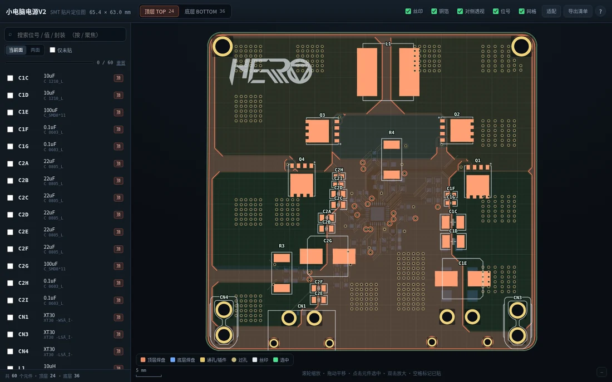
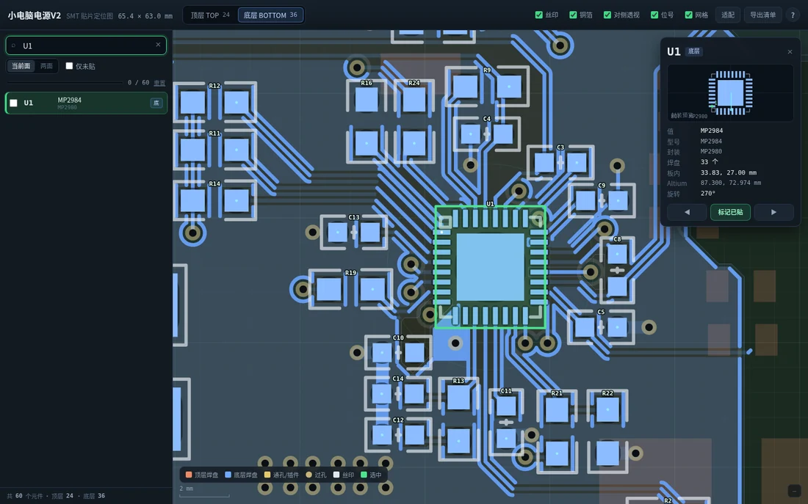

# PCB → SMT Placement Map (`pcb-smt-viewer`)

Turn a PCB design file into a **single-file, offline HTML “SMT placement map”** — the board
drawn from the real design data, with a searchable designator list, top/bottom (mirrored) views,
a placed-component checklist and a CSV export.

Built as a [DeepSeek Harness](https://github.com/deepseek-ai) **skill**, but every script is a
plain Python CLI and works without the harness.

<p align="center">
  
</p>

**One command. Auto-detects the format.**

```bash
python3 scripts/pcb2viewer.py <file-or-project-or-zip> [outdir]
```

| Backend | Input | Component data from |
| --- | --- | --- |
| `altium` | Altium `.PcbDoc` (+ same-name `.SchDoc`), project `.zip` | Components6 / Pads6 |
| `kicad` | KiCad `.kicad_pcb`, project `.zip` | footprint + pad |
| `easyeda_pro` | 嘉立创EDA Professional `.epro` / project `.zip` / `.eprj3` folder / `.eprj` | COMPONENT / PAD |
| `easyeda_std` | 嘉立创EDA Standard PCB `.json` | FOOTPRINT / PAD |
| `gerber` | Gerber (RS-274X) + Excellon drill + **pick-and-place CSV** | the centroid file |

Anything else (PADS, Allegro, Eagle, JLCPCB online order page, …) goes through the **`gerber`**
backend — export Gerber + drill + pick-and-place, which is exactly what JLCPCB SMT ordering asks for.

## What you get

```
<board>_贴片定位图.html      ← the deliverable: one self-contained file (~0.9 MB), double-click to open
<board>_贴片定位图.README.md  ← board size + component table (designator / side / value / package / XY / rotation)
pcb_data.json               ← normalised intermediate data (re-pack with build_html.py)
source/…                    ← original project, extracted when the input was a zip
```

<p align="center">
  
</p>

### In the page

- **Top / Bottom toggle** — the bottom view is mirrored, i.e. the direction you actually see when
  you flip the board over. A faint “see-through” of the other side helps you orient.
- **Search** — designator (`R19`), value (`22uF`) or package (`0603`); Enter jumps to the part,
  zooms and highlights it. Exact designator matches rank first.
- **Component card** — footprint preview, value/mpn, pad count, in-board XY (from the board’s
  lower-left corner), raw coordinates, rotation.
- **Pin-1 dot** — a small cyan dot on pad 1, so you can check orientation before soldering.
- **Checklist** — mark parts placed (Space or checkbox); progress is stored in `localStorage`,
  “next unplaced” jumps automatically. Export to CSV any time.
- **Keyboard** — `/` search, `↑↓` next/prev, `T`/`B` side, `F` fit, `+`/`-` zoom, `Space` mark, `Esc` cancel.

## Install

### As a DeepSeek Harness skill (recommended)

```bash
git clone https://github.com/PaiJiang153/pcb-smt-viewer.git
./pcb-smt-viewer/install.sh          # copies to ~/.agents/skills/pcb-smt-viewer
```

`install.sh` installs into whichever user skill root your harness scans
(`~/.agents/skills/<name>/` by default, `~/.dsh/skills/<name>/` with `--dsh`).
The harness hot-reloads this directory — the skill shows up in the catalog immediately,
then you can just ask the agent *“use pcb-smt-viewer to make a placement map from board.zip”*.

### As a plain CLI

```bash
python3 -m pip install --user olefile      # only needed by the Altium backend
python3 scripts/pcb2viewer.py my_board.zip
```

Requirements: Python 3.7+. Optional: Node + Playwright for the browser self-check
(`scripts/verify.mjs`).

## Usage

```bash
# auto-detect (Altium / KiCad / EasyEDA Standard+Pro / Gerber)
python3 scripts/pcb2viewer.py board.zip out/

# force a backend
python3 scripts/pcb2viewer.py --format kicad my.kicad_pcb out/

# Gerber set + pick-and-place file
python3 scripts/pcb2viewer.py --format gerber gerbers.zip --centroid JLCPCB_pick_and_place.csv

# list backends / debug one backend
python3 scripts/pcb2viewer.py --list-formats
python3 scripts/test_backend.py kicad my.kicad_pcb --build out/ --verify

# re-pack the HTML after tweaking CSS/JS (no re-parsing needed)
python3 scripts/build_html.py pcb_data.json out.html --title "My Board"
```

How to export from each EDA:

| Your EDA | Export this |
| --- | --- |
| 嘉立创EDA Professional | File → Export → **EasyEDA Pro project** (`.epro`), or Export → **Altium** and use the `altium` backend |
| 嘉立创EDA Standard | in the PCB document: File → **Save as / Export → EasyEDA file (.json)** |
| KiCad | just give the `.kicad_pcb` (or the whole project zip) |
| Altium Designer | the `.PcbDoc` (keep the same-name `.SchDoc` next to it for value/mpn); or the project zip |
| anything else | export **Gerber** (outline + copper + silk) + **drill** + **pick-and-place CSV** |

No pick-and-place file → the board still renders (copper/silk/outline) but there are no
designators; the tool warns about it.

## How it works

```
PCB file ──► scripts/parsers/<format>.py ──► pcb_data.json ──► scripts/build_html.py ──► one HTML
             (sniff + parse, mm, Y-up)        (one shared schema)   (inlines css/js/data)
```

`scripts/parsers/common.py` is the contract: constants (layer ids), `finalize()` (board bbox,
per-component pad boxes, pin-1, statistics, sanity warnings) and shared geometry helpers
(arc flattening, board-outline hairline trimming, point-in-polygon).

### Adding a format

1. Create `scripts/parsers/myfmt.py`:

```python
FORMAT = "myfmt"
LABEL  = "My EDA (.xxx)"
def sniff(root) -> bool: ...                    # file or dir, must not raise
def parse(root, out_dir=None, **opts) -> dict:  # raw canonical dict
    ...
```

2. Return the raw dict (only the fields you have) — `common.finalize()` fills the rest.
3. Add `"myfmt"` to `BACKEND_ORDER` in `scripts/pcb2viewer.py`.
4. Drop a sample into `tests/fixtures/myfmt/` and run
   `python3 scripts/test_backend.py myfmt tests/fixtures/myfmt/x --build`.

## Tests

```bash
./tests/run_all.sh                 # builds every bundled fixture through every backend
./tests/run_all.sh --verify        # …and runs the headless-browser check (needs Playwright)
./tests/fetch_fixtures.sh          # download the third-party boards/gerbers (see tests/fixtures/*/PROVENANCE.md)
```

Bundled fixtures are either synthesised by this project or MIT-licensed
([`Daaga1.3V.epro`](https://github.com/enkhbold470/epro2kicad)); GPL/unlicensed real boards are
**not** redistributed here — `fetch_fixtures.sh` downloads them for local regression runs, and each
`PROVENANCE.md` records the exact source, commit and licence.

## Limitations

- **Gerber backend** has no component→pad attribution of its own: designators come from the
  pick-and-place file; aperture macros are approximated by their bounding box; negative planes,
  inner layers and mask layers are not rendered; panels are treated as one board.
- **EasyEDA Standard**: copper areas are drawn as their outline (no hatch/thermal reconstruction);
  text primitives are not rendered.
- **EasyEDA Pro**: legacy `.eprj` (SQLite) support depends on the internal schema — if it fails, use
  `.epro` or export Altium.
- **KiCad**: custom/trapezoid pads are approximated as rectangles; pad/silk text is not drawn
  (the viewer draws its own designators).
- **Altium**: custom pad shapes are approximated as rectangles; inner copper is only ghosted.
- Boards with >4 layers are shown as top/bottom only (which is what hand placement needs).
- Hairline artefacts inside a board outline are trimmed automatically (`--no-spur-trim` disables).

## License

[MIT](LICENSE) for the code. Third-party test data keeps its original licence — see
`tests/fixtures/*/PROVENANCE.md`.

Screenshots in `examples/` show a real board and are published with the permission of its author
(the repository owner).
