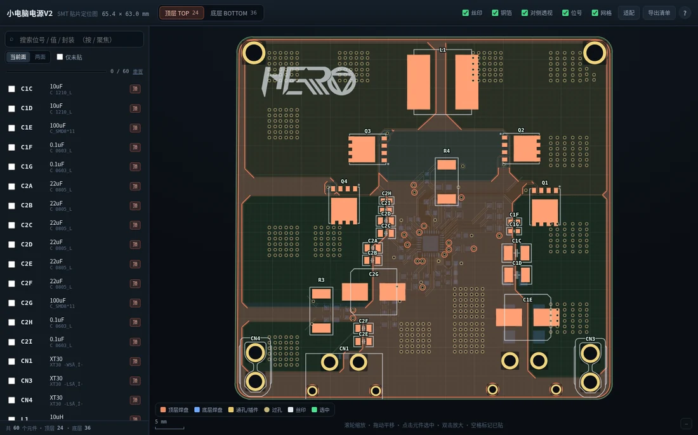
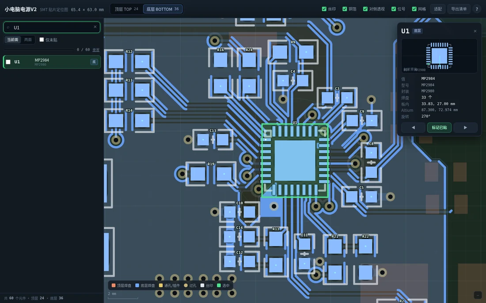

# PCB → 贴片定位图（`pcb-smt-viewer`）

把 PCB 设计文件一键转成**单文件、可离线打开的「SMT 贴片定位图」网页**：板子图形 + 位号搜索定位
+ 顶层/底层镜像切换 + 贴片勾选清单 + CSV 导出。

它同时是一个 [DeepSeek Harness](https://github.com/deepseek-ai) **skill**，但所有脚本就是普通 Python CLI，
没有 harness 也能用。

<p align="center">
  
</p>

**一条命令，自动识别格式：**

```bash
python3 scripts/pcb2viewer.py <文件/工程目录/zip> [输出目录]
```

| 后端 | 认什么文件 | 元件/位号来自 |
| --- | --- | --- |
| `altium` | Altium `.PcbDoc`（+ 同名 `.SchDoc`）、工程 `.zip` | Components6 / Pads6 |
| `kicad` | KiCad `.kicad_pcb`、工程 `.zip` | footprint + pad |
| `easyeda_pro` | 嘉立创EDA 专业版 `.epro` / 工程 `.zip` / `.eprj3` 文件夹 / `.eprj` | COMPONENT / PAD |
| `easyeda_std` | 嘉立创EDA 标准版 PCB `.json` | FOOTPRINT / PAD |
| `gerber` | Gerber(RS-274X) + Excellon 钻孔 + **坐标文件 CSV** | 坐标文件（Pick&Place） |

**任何其它 EDA**（PADS / Allegro / Eagle / 立创下单页…）都能走 `gerber` 后端：导出 Gerber +
钻孔 + 坐标文件即可 —— 这也正是嘉立创 SMT 下单要求的那套文件。

## 输出

```
<板名>_贴片定位图.html        ← 交付物：单文件（约 0.9 MB），双击打开
<板名>_贴片定位图.README.md    ← 板尺寸 + 元件清单表（位号/层/值/型号/封装/坐标/角度）
pcb_data.json                 ← 归一化后的中间数据（可再喂给 build_html.py 换样式重打包）
source/…                      ← 输入是 zip 时解出来的原始工程
```

<p align="center">
  
</p>

### 网页里有什么

- **顶层/底层切换**：底层是镜像翻转（和把板翻过来贴片的方向一致），可开「对侧透视」辅助定位。
- **搜索**：位号（R19）、值（22uF）、封装（0603）都能搜；回车自动切面、缩放、高亮，位号精确匹配优先。
- **元件信息卡**：封装预览、值/型号、焊盘数、板内坐标（从板左下角起）、原始坐标、旋转角。
- **1 脚标记**：1 号焊盘上的青色小点，用来确认方向。
- **贴片清单**：空格/勾选框标记已贴，进度存在浏览器本地，自动跳下一颗未贴；随时导出 CSV。
- **快捷键**：`/` 搜索、`↑↓` 切换、`T`/`B` 层面、`F` 适配、`+`/`-` 缩放、`空格` 标记、`Esc` 取消。

## 安装

### 装成 DeepSeek Harness skill（推荐）

```bash
git clone https://github.com/PaiJiang153/pcb-smt-viewer.git
./pcb-smt-viewer/install.sh          # 复制到 ~/.agents/skills/pcb-smt-viewer
```

`install.sh` 默认装进 `~/.agents/skills/<name>/`（harness 会自动扫描并热加载）；加 `--dsh`
则装进 `~/.dsh/skills/<name>/`。装好后在对话里说「用 pcb-smt-viewer 把 xxx.zip 做成贴片图」即可。

### 当普通命令行工具用

```bash
python3 -m pip install --user olefile      # 只有 Altium 后端需要
python3 scripts/pcb2viewer.py 我的板子.zip
```

依赖：Python 3.7+；可选 Node + Playwright 用于浏览器自检（`scripts/verify.mjs`）。

## 用法

```bash
# 自动识别（Altium / KiCad / 嘉立创标准版+专业版 / Gerber）
python3 scripts/pcb2viewer.py 板子.zip out/

# 强制指定后端
python3 scripts/pcb2viewer.py --format kicad my.kicad_pcb out/

# Gerber 套件 + 坐标文件
python3 scripts/pcb2viewer.py --format gerber gerbers.zip --centroid 坐标文件.csv

# 看后端列表 / 单后端调试
python3 scripts/pcb2viewer.py --list-formats
python3 scripts/test_backend.py kicad my.kicad_pcb --build out/ --verify

# 改完 CSS/JS 只重新打包网页（不必重新解析）
python3 scripts/build_html.py pcb_data.json out.html --title "板名"
```

各 EDA 怎么导出：

| 你的 EDA | 导出方式 |
| --- | --- |
| 嘉立创EDA 专业版 | 文件 → 导出 → **EasyEDA Pro 工程**（`.epro`）；或 导出 → **Altium** 后走 `altium` 后端 |
| 嘉立创EDA 标准版 | PCB 文档里 文件 → **另存为/导出 → EasyEDA 文件 (.json)** |
| KiCad | 直接给 `.kicad_pcb`（或整个工程 zip） |
| Altium Designer | 直接给 `.PcbDoc`（同名 `.SchDoc` 放在一起，型号/值才完整）；或工程 zip |
| 其它 | 导出 **Gerber**（板框+铜层+丝印）+ **钻孔** + **坐标文件 CSV** |

没有坐标文件时：板子/铜皮/丝印照样画，但没有位号（脚本会警告）。

## 工作原理

```
PCB 文件 ──► scripts/parsers/<格式>.py ──► pcb_data.json ──► scripts/build_html.py ──► 单个 HTML
            (sniff + parse，mm，Y 轴向上)    (统一 schema)      (把 css/js/data 内联)
```

`scripts/parsers/common.py` 是统一契约：图层常量、`finalize()`（板框包围盒、元件焊盘框、1 脚、
统计、合理性警告）和公共几何工具（圆弧打散、板框毛刺清理、点在多边形内）。

### 新增一种格式

1. 新建 `scripts/parsers/myfmt.py`：

```python
FORMAT = "myfmt"
LABEL  = "我的 EDA (.xxx)"
def sniff(root) -> bool: ...                    # 文件或目录，不能抛异常
def parse(root, out_dir=None, **opts) -> dict:  # 返回原始 canonical dict
    ...
```

2. 只需填你有的字段，剩下的交给 `common.finalize()`。
3. 把 `"myfmt"` 加到 `scripts/pcb2viewer.py` 的 `BACKEND_ORDER`。
4. 放样例到 `tests/fixtures/myfmt/`，跑
   `python3 scripts/test_backend.py myfmt tests/fixtures/myfmt/x --build`。

## 测试

```bash
./tests/run_all.sh                 # 用仓库自带的夹具把所有后端跑一遍
./tests/run_all.sh --verify        # 再跑无头浏览器检查（需要 Playwright）
./tests/fetch_fixtures.sh          # 下载第三方测试板/gerber（见各 PROVENANCE.md）
```

仓库里自带的夹具要么是本项目合成的，要么是 MIT 许可的
（[`Daaga1.3V.epro`](https://github.com/enkhbold470/epro2kicad)）。GPL / 无许可的真实板子**不随仓库分发**，
由 `fetch_fixtures.sh` 按需下载，来源/commit/许可证都记在各目录的 `PROVENANCE.md` 里。

## 已知限制

- **Gerber 后端**：本身没有元件信息，位号完全依赖坐标文件；光圈宏按外接矩形近似；负片、
  内层、阻焊层不渲染；拼板当成一整块。
- **嘉立创EDA 标准版**：覆铜按轮廓画实心（不还原网格/热焊盘）；文字图元不画。
- **嘉立创EDA 专业版**：旧 `.eprj`（SQLite）取决于内部表结构，失败时用 `.epro` 或导出 Altium。
- **KiCad**：自定义/梯形焊盘按矩形近似；焊盘和丝印文字不画（位号由网页自己画）。
- **Altium**：自定义形状焊盘按矩形近似；内层铜只做淡显。
- 4 层以上板子只看顶/底两面（手工贴片通常只看外层）；板框里的细长毛刺会自动剔除
  （`--no-spur-trim` 可关闭）。

## 许可证

代码使用 [MIT](LICENSE)。第三方测试数据保持其原始许可证，见 `tests/fixtures/*/PROVENANCE.md`。

`examples/` 里的截图是作者本人的板子，已获授权发布。
